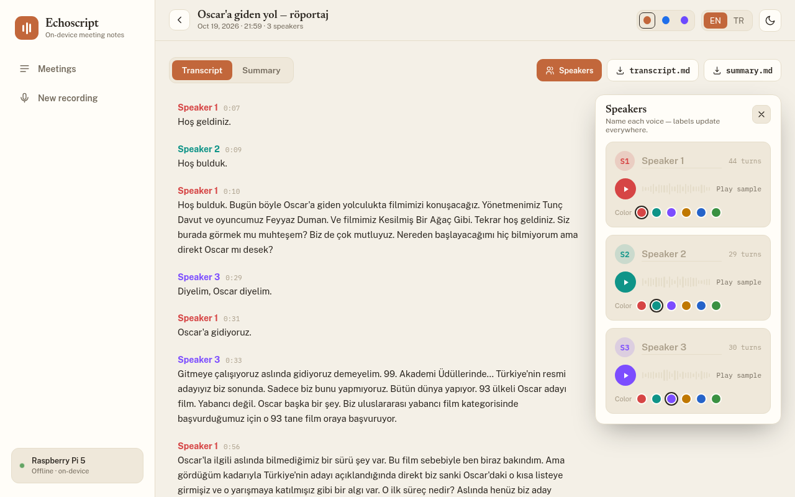
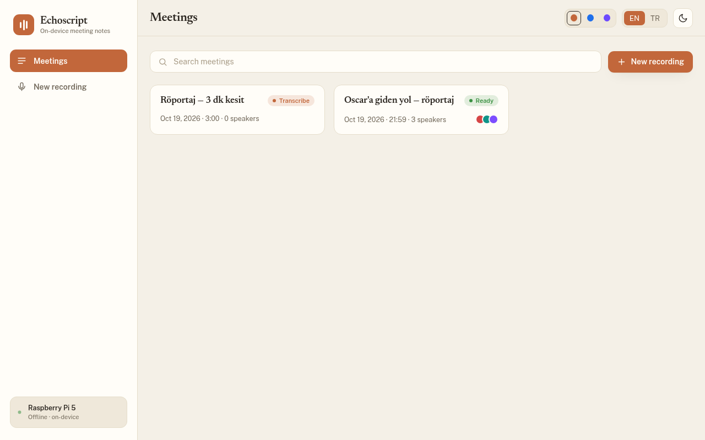
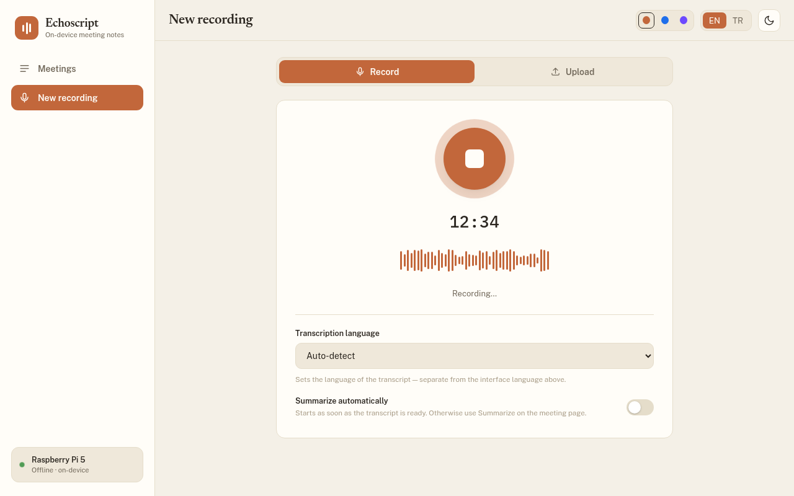
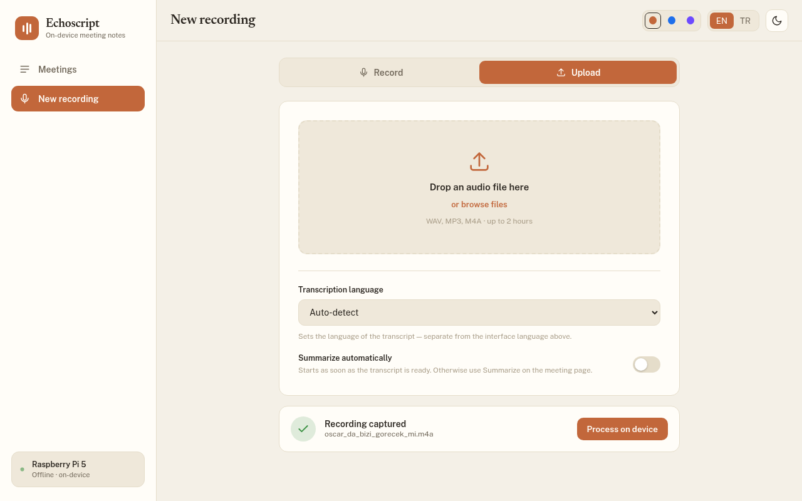
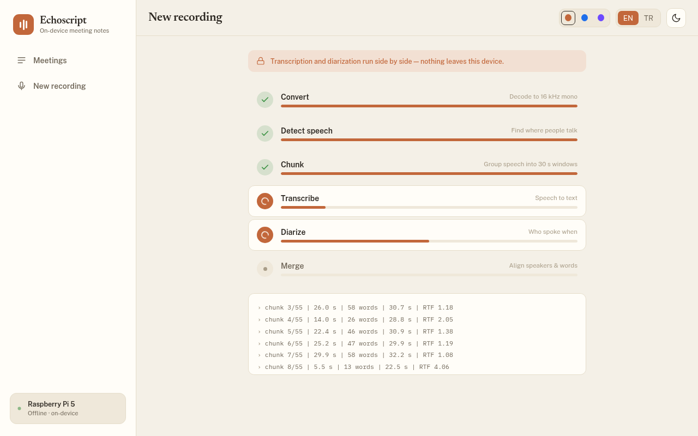
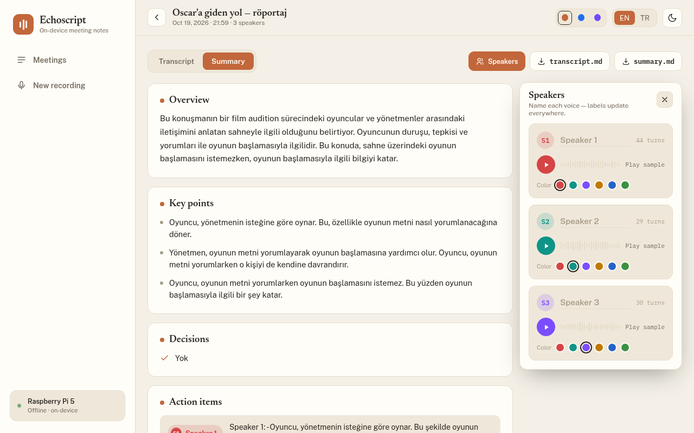
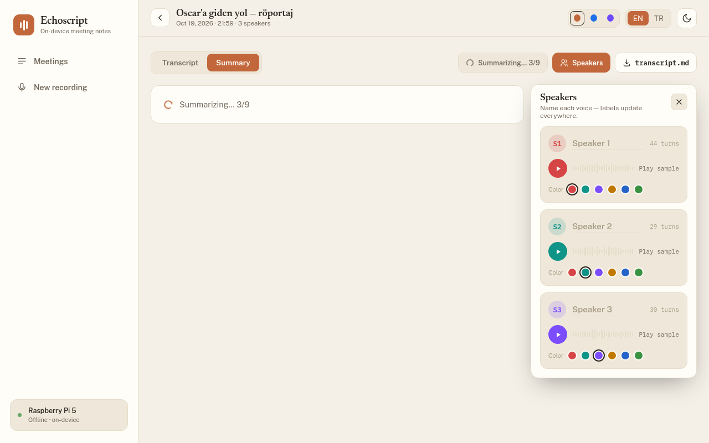
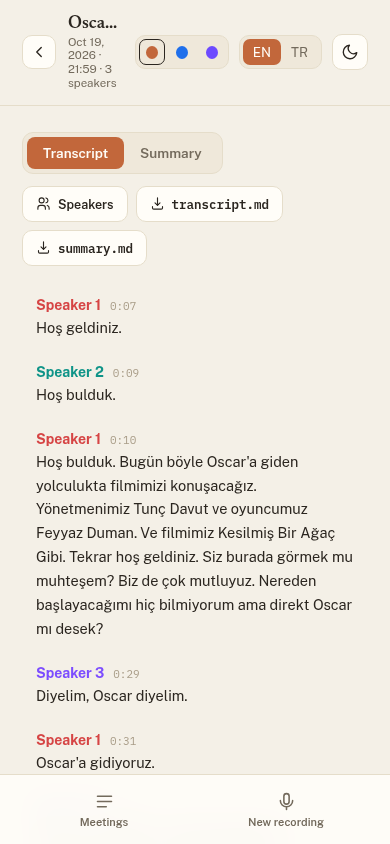
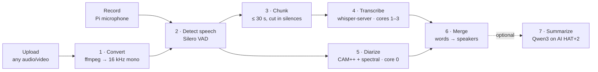

# Echoscript

**Private meeting notes on a single Raspberry Pi 5.** Record a meeting with the Pi's microphone, or
upload a recording. Echoscript gives you a transcript that shows who said what, and a short summary.
It all runs on the Pi; no audio or text leaves it.



## Built to run on one Raspberry Pi

Echoscript is designed for one Raspberry Pi 5: no cloud, no GPU, no second machine. Every design
choice was measured on the Pi itself, and the pipeline was shaped around its four cores and around
whisper's fixed cost per request. The measurements are in [DOCUMENTATION.md](DOCUMENTATION.md).

- **The cores are split, not shared.** `whisper-server` runs on cores 1–3 and keeps the model
  loaded between jobs. The web app, the recorder and the rest of the pipeline run on core 0. A
  fourth whisper thread would gain only 8%.
- **A recording is transcribed while it is still going on.** Speech is sent to whisper whenever it
  is free. When you press stop, only the last few chunks and the speaker step are left. In simulation
  this left **0.8–5.2 min** of waiting after a 22–31 min recording, compared with 22–35 min when
  transcribing only after stop.
- **Every whisper request costs about 22 s, however short the audio.** So chunks are packed as full
  as possible, up to 30 s, and cut in silences. A cut that can't wait for a silence goes at the
  quietest moment, so words aren't split.
- **The models were picked for the Pi.**
  - large-v3-turbo **q8_0** encodes 2.4× faster than q5_0 on the Pi 5, with the same text.
  - **CAM++** speaker voiceprints give the same speakers as ResNet34, **3.2× faster**.
  - The speaker step runs on core 0 *during* transcription and slows it down by only ~15% for the
    few minutes it takes. The transcript never waits for it.
- **The summary runs on the AI HAT+2** (Qwen3-1.7B on the Hailo-10H), so it doesn't compete for the
  CPU.
- **Small memory footprint.** Each job runs in its own process and gives its memory back when it
  ends. The peak is **1.7 GiB** of RAM: transcription and the speaker step together, next to the
  loaded whisper model.

## What it does

- **Records** from a microphone on the Pi, started and stopped from any browser on the network.
- **Uploads** any audio or video file that ffmpeg can read.
- **Transcribes** with Whisper large-v3-turbo (whisper.cpp), in Turkish, English or auto-detect.
- **Separates speakers** without being told how many there are (CAM++ voiceprints, spectral
  clustering).
- **Speaker names and colours** are set once in the UI and shown everywhere. A short voice sample
  of each speaker helps you tell them apart.
- **Summarizes** into an overview, key points, decisions and action items: automatically as soon as
  the transcript is ready, or when you press *Summarize*. The transcript never waits for it.
- **Exports** the transcript and the summary as Markdown.
- **Interface** in English or Turkish, light or dark, three colour themes; works on a phone.

## Screenshots

| Meetings | Recording on the Pi |
|---|---|
|  |  |
| **Upload** | **Processing: transcription and speakers side by side** |
|  |  |
| **Transcript and speakers** | **Summary** |
|  |  |
| **Summary on request: the button shows its progress** | |
|  | |

<p align="center"></p>

The screenshots show a public 22-minute Turkish interview processed on the Pi.

## How it works



Each step reads the files of the step before it and writes its own into
`data/sessions/<meeting>/`, so any step can be rerun on its own.

| # | Step | What happens | Output |
|---|---|---|---|
| 1 | **Convert** | ffmpeg decodes the upload to 16 kHz mono WAV. A recording is already in that format and skips this step | `audio.wav` |
| 2 | **Detect speech** | Silero VAD finds where people talk. During a recording it runs live, so the speech regions are ready at stop | `vad.json` |
| 3 | **Chunk** | Speech is packed into chunks of up to 30 s, cut in silences; a silence over 2 s always ends a chunk. Speech over 30 s without a pause is cut at the quietest point of its last 5 s | `chunks.json` |
| 4 | **Transcribe** | Each chunk goes to `whisper-server`, with the last 200 characters of text as context. Every word comes back with its time | `words.json` |
| 5 | **Diarize** | 1.5 s windows every 0.75 s, a 512-d CAM++ voiceprint for each window, then spectral clustering, which also finds the number of speakers. Runs **in parallel** with step 4, on the other core | `turns.json` |
| 6 | **Merge** | Every word gets the speaker who was talking at that time. Each speaker change then moves to the nearest pause or sentence end, so sentences aren't cut in two. Words become utterances | `transcript.json` |
| 7 | **Summarize** (optional) | A separate job after the transcript is ready: started automatically if *Summarize automatically* was on, otherwise with the *Summarize* button. A local LLM fills four sections (overview, key points, decisions, action items); a long transcript is summarized in parts that are then merged. If it fails, only the summary shows an error | `summary.md` |

**Recording vs upload.** An upload runs steps 1–6 after it arrives. A recording runs steps 2–4
*while you talk*; after stop, only the last chunks, diarization and merge are left. The meeting is
ready when its transcript is. The summary follows if you asked for it.

Every design choice above has a measured reason: [DOCUMENTATION.md](DOCUMENTATION.md) Part 1
(chunking), Part 2 (diarization; how it works in §11) and Part 3 (memory).

## Measured on the Pi 5

| | Result |
|---|---|
| Transcription accuracy (Turkish interview, against a hand-corrected reference) | **CER 3.3% · WER 6.6%** |
| 22 min interview uploaded through the web app: transcript ready | **24 min 55 s** (whisper is the limit, 1.13× real time) |
| ...then the automatic summary on the AI HAT+2 | 15 min 38 s (40 min 33 s in total) |
| Waiting after stop for a live recording (simulated, 22–31 min) | 0.8–5.2 min for the transcript, plus diarization |
| Diarization alone, 30 min meeting | ~2.6 min on one core |
| Speakers found on three 3-speaker recordings (never told the count) | 3 / 3 / 3 |
| Peak RAM of Echoscript, measured during that run | **1.70 GiB** (whisper-server 1.04 GiB of it) |
| Temperature during that run | peak 70 °C, never throttled |

## Running it

Echoscript has three parts:
1. **whisper-server** from whisper.cpp, with the model loaded.
2. **The Python app** (`main.py`), which serves the web page and runs the pipeline.
3. **Optionally, a summary backend:** the AI HAT+2, or `llama-server` on the CPU.

It was developed and tested on a **Raspberry Pi 5 (16 GB) with Raspberry Pi OS (Debian 13),
Python 3.13 and whisper.cpp 1.9.5**. Other Linux machines, macOS and Windows can run it for
uploads, but **they have not been tested**.

**Starting `main.py` alone is not enough.** The web page opens, but a meeting needs these too:

| Needed | For | Without it |
|---|---|---|
| `whisper-server` at `[stt] server_url` | Transcription, every meeting | The meeting fails at *Transcribe*: `Connection refused` |
| A summary backend: the AI HAT+2, or `llama-server` with `backend = "llama"` | The summary (optional) | The summary shows an error and a *Try again* button; the transcript is not affected |
| `ffmpeg` on the `PATH` | Uploads (*Convert*) | Uploads fail at *Convert* |
| The three model files in `models/` | Speech detection, transcription, diarization | The step that needs it fails |
| `arecord` and a microphone (`[record] device`) | Recording | *Record* shows an error; uploads still work |

### Raspberry Pi 5 (recommended)

**Hardware:**
- Raspberry Pi 5. Developed on 16 GB; 4 GB should be enough judging by the 1.7 GiB peak, but this
  has not been tested.
- An active cooler.
- A USB microphone.
- Optional: the AI HAT+2 for summaries.

**1. System packages and whisper.cpp, with the small Echoscript patch:**

```bash
sudo apt update
sudo apt install -y build-essential cmake git ffmpeg python3-venv python3-dev alsa-utils

git clone https://github.com/AliOzcelik/Echoscript.git ~/Echoscript
git clone https://github.com/ggml-org/whisper.cpp ~/src/whisper.cpp
cd ~/src/whisper.cpp
git apply ~/Echoscript/patches/whisper-server-single-segment.patch
cmake -B build -DCMAKE_BUILD_TYPE=Release -DGGML_NATIVE=ON
cmake --build build -j4 --config Release
```

The patch adds one request option, `single_segment`. It lets whisper decode each chunk in one
encoder pass instead of encoding a second 30 s window for a short tail (~25 s per chunk on the
Pi). An unpatched server still works; it ignores the option and is slower.

**2. Models** (into `~/Echoscript/models`):

```bash
cd ~/src/whisper.cpp
sh ./models/download-ggml-model.sh large-v3-turbo
./build/bin/whisper-quantize models/ggml-large-v3-turbo.bin ~/Echoscript/models/ggml-large-v3-turbo-q8_0.bin q8_0

cd ~/Echoscript/models
wget https://github.com/snakers4/silero-vad/raw/master/src/silero_vad/data/silero_vad.onnx
wget https://github.com/k2-fsa/sherpa-onnx/releases/download/speaker-recongition-models/3dspeaker_speech_campplus_sv_en_voxceleb_16k.onnx
```

Older whisper.cpp builds call the binary `quantize` instead of `whisper-quantize`.

**3. Python environment:**

```bash
cd ~/Echoscript
python3 -m venv venv
venv/bin/pip install -r requirements.txt
```

**4. Configure `config.toml`:**
- `[record] device`: your microphone. `arecord -L` lists the ALSA devices, e.g.
  `"plughw:CARD=Device,DEV=0"`.
- `[stt] language`: `"tr"`, `"en"` or `"auto"`. The UI can also set it for each meeting.

**5. Summary (optional), with the AI HAT+2:**
1. Install HailoRT for the AI HAT+2, following Raspberry Pi's AI HAT+2 documentation.
2. Install the HailoRT Python wheel into the venv. It is not on PyPI:
   `venv/bin/pip install hailort-<version>-cp313-cp313-linux_aarch64.whl`.
3. Point `[summary] hailo_model` at `Qwen3-1.7B-Instruct.hef`.

Without the HAT, use `backend = "llama"` (see below).

**6. Start it:**

```bash
# whisper on cores 1-3, model kept loaded
taskset -c 1-3 ~/src/whisper.cpp/build/bin/whisper-server \
    -m models/ggml-large-v3-turbo-q8_0.bin -l tr -t 3 --port 8080 &

# the app on core 0 (it pins each pipeline job to core 0 itself)
taskset -c 0 venv/bin/python main.py
```

Open **`http://<pi-address>:8000`** from any browser on your network. To start both at boot, make
them two systemd services with the same commands.

### Linux, macOS and Windows computers

The steps are the same as on the Pi, with these differences:

| | Linux (x86/ARM) | macOS | Windows |
|---|---|---|---|
| Recording from the page | Works: ALSA `arecord` (`alsa-utils`) | Upload only: no `arecord` | Upload only: no `arecord` |
| ffmpeg | `sudo apt install ffmpeg` | `brew install ffmpeg` | `winget install Gyan.FFmpeg` |
| Build tools for whisper.cpp | `build-essential cmake git` | Xcode Command Line Tools, `brew install cmake` | Visual Studio Build Tools (C++), CMake, Git |
| whisper-server binary | `build/bin/whisper-server` | `build/bin/whisper-server` (uses Metal on Apple Silicon) | `build\bin\Release\whisper-server.exe` |
| Core pinning | `taskset` as above | none: the app skips it | none: the app skips it |
| Summary | `llama` backend | `llama` backend | `llama` backend |

On a computer without `arecord`, pressing Record shows an error and nothing else happens. Uploads
work everywhere.

**macOS / Linux:**

```bash
git clone https://github.com/ggml-org/whisper.cpp ~/src/whisper.cpp
cd ~/src/whisper.cpp
git apply /path/to/echoscript/patches/whisper-server-single-segment.patch
cmake -B build -DCMAKE_BUILD_TYPE=Release
cmake --build build -j --config Release
sh ./models/download-ggml-model.sh large-v3-turbo
./build/bin/whisper-quantize models/ggml-large-v3-turbo.bin /path/to/echoscript/models/ggml-large-v3-turbo-q8_0.bin q8_0

cd /path/to/echoscript
curl -L -o models/silero_vad.onnx https://github.com/snakers4/silero-vad/raw/master/src/silero_vad/data/silero_vad.onnx
curl -L -o models/3dspeaker_speech_campplus_sv_en_voxceleb_16k.onnx https://github.com/k2-fsa/sherpa-onnx/releases/download/speaker-recongition-models/3dspeaker_speech_campplus_sv_en_voxceleb_16k.onnx
python3 -m venv venv
venv/bin/pip install -r requirements.txt

~/src/whisper.cpp/build/bin/whisper-server -m models/ggml-large-v3-turbo-q8_0.bin -l tr -t 4 --port 8080 &
venv/bin/python main.py          # then open http://localhost:8000
```

**Windows (PowerShell):**

```powershell
git clone https://github.com/ggml-org/whisper.cpp $HOME\src\whisper.cpp
cd $HOME\src\whisper.cpp
git apply C:\path\to\echoscript\patches\whisper-server-single-segment.patch
cmake -B build
cmake --build build --config Release
.\models\download-ggml-model.cmd large-v3-turbo
.\build\bin\Release\whisper-quantize.exe models\ggml-large-v3-turbo.bin C:\path\to\echoscript\models\ggml-large-v3-turbo-q8_0.bin q8_0

cd C:\path\to\echoscript
Invoke-WebRequest https://github.com/snakers4/silero-vad/raw/master/src/silero_vad/data/silero_vad.onnx -OutFile models\silero_vad.onnx
Invoke-WebRequest https://github.com/k2-fsa/sherpa-onnx/releases/download/speaker-recongition-models/3dspeaker_speech_campplus_sv_en_voxceleb_16k.onnx -OutFile models\3dspeaker_speech_campplus_sv_en_voxceleb_16k.onnx
python -m venv venv
venv\Scripts\pip install -r requirements.txt

Start-Process $HOME\src\whisper.cpp\build\bin\Release\whisper-server.exe -ArgumentList "-m models\ggml-large-v3-turbo-q8_0.bin -l tr -t 4 --port 8080"
venv\Scripts\python main.py      # then open http://localhost:8000
```

Set `-t` to the number of cores you want whisper to use.

**Summary without the AI HAT+2:**
1. Run [llama.cpp](https://github.com/ggml-org/llama.cpp)'s `llama-server` with a small instruct
   model on port 8081, e.g. `llama-server -hf Qwen/Qwen3-1.7B-GGUF:Q8_0 --port 8081`.
2. Set `[summary] backend = "llama"` in `config.toml`.

On the Pi this uses the CPU, which whisper also needs.

### Without the web page

The pipeline also runs from the command line. Every step writes its files to
`data/sessions/<file name>/`:

```bash
python -m pipeline.run meeting.m4a --parallel             # all steps, STT and diarization in parallel
python -m pipeline.run meeting.m4a --from diar            # redo speakers, merge and summary only
python -m pipeline.run meeting.m4a --from merge --to merge
```

The result is `transcript.txt`, with lines like `[0:00:29] SPK_2: Diyelim, Oscar diyelim.`.
The `*.labels.txt` files open as label tracks in Audacity, over `audio.wav`.

## Configuration

Everything that can be tuned is in [`config.toml`](config.toml):

| Section | Main settings |
|---|---|
| `[record]` | ALSA device of the microphone |
| `[vad]` | Silero thresholds, minimum speech and silence |
| `[stt]` | whisper-server URL, language, greedy or beam search, prompt length, chunk length |
| `[diar]` | Voiceprint model, `spectral` or `ahc`, minimum speaker size, a fixed speaker count (0 = find it) |
| `[summary]` | `hailo` or `llama`, model, reply length, temperature |

The fixed design choices (window sizes, merge rules) are constants at the top of the files in
`pipeline/`, with a comment on why each has its value.

## Repository layout

```
main.py                     web app: UI, recorder with live VAD and live transcription, job queue
Echoscript_standalone.html  the UI, one self-contained file (React and fonts bundled; works offline)
ui_logic.js                 the UI's logic, packed into the HTML by tools/ui_bundle.py
config.toml                 all settings
pipeline/                   run.py (stages), vad.py, stt.py, live.py, diar.py, merge.py, summarize.py
eval/                       benchmarks: WER/CER, DER/WDER, chunking, diarization grids, cost
patches/                    the whisper-server patch
docs/screenshots/           the images above
DOCUMENTATION.md            what was measured and why the pipeline works the way it does
```

`models/` (~1 GB), `data/` and `recordings/` are not part of the repository.

## Known limitations

- **Summaries of long meetings are weak.** Qwen3-1.7B on the AI HAT+2 has a 2048-token context, so a
  22 min interview is summarized in 9 parts, which are then merged (~15 min). The result can miss the
  main topic and repeat itself; the summary in the screenshot above is such a case. Short meetings
  come out better.
- **Diarization has not been scored against labels yet.** The settings were chosen by speaker counts,
  by agreement between two independent models, and by cost (DOCUMENTATION.md §13). Speaker changes
  can still land a word or a sentence off.
- **Recording from the page needs Linux with ALSA.** On macOS and Windows only uploads work.
- **Tested only on the Raspberry Pi 5.** Other systems should work but have not been tried.

## Acknowledgements

- [whisper.cpp](https://github.com/ggml-org/whisper.cpp) and OpenAI Whisper large-v3-turbo
- [Silero VAD](https://github.com/snakers4/silero-vad)
- CAM++ from [3D-Speaker](https://github.com/modelscope/3D-Speaker), ONNX export from
  [sherpa-onnx](https://github.com/k2-fsa/sherpa-onnx)
- NME-SC spectral clustering: Park et al., *Auto-Tuning Spectral Clustering for Speaker Diarization
  Using Normalized Maximum Eigengap*, IEEE SPL 2019
- [Qwen3](https://github.com/QwenLM/Qwen3) on the Raspberry Pi AI HAT+2 (Hailo-10H)
